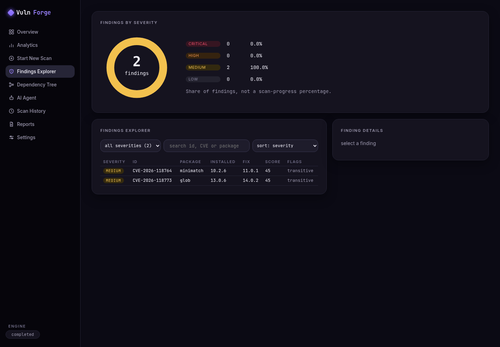

# VulnForge

**Dependency vulnerability scanning, a local dashboard, and an experimental small-model research track.**

VulnForge is a TypeScript graduation project that turns project dependencies into
OSV-backed findings, explains why each finding matters, and keeps the evidence
separate from optional AI suggestions.

> **Project status:** the dependency scanner, CLI, terminal UI, and dashboard are
> implemented. Forge can provide optional explanations and fix suggestions. A
> separately fine-tuned code-classification model has been evaluated in Colab,
> but **it is not integrated into this scanner as a source-code detector**.
> Reachability analysis is also not implemented.

## Dashboard



_An actual local scan, not a mockup. This example has two medium-severity findings.
Advisory counts, IDs, and fixes can change as OSV data changes._

## What it does

- Reads npm dependency projects and supported pnpm workspaces, plus Python
  `requirements.txt` projects.
- Queries OSV for known vulnerabilities, hydrates advisory details, caches
  responses, and records coverage gaps instead of claiming an incomplete scan
  is clean.
- Ranks findings using an explicit priority heuristic, with dependency-tree and
  fixed-version context.
- Writes a validated JSON report, schema version 6, and prints a readable table
  or JSON through the CLI.
- Offers an interactive terminal UI and a local React dashboard with findings,
  dependency views, analytics, AI suggestions, and report export.
- Automatically opens results after a scan and shows severity counts and
  percentage shares. These percentages describe **findings**, not scan progress.
- Saves the latest 50 dashboard reports locally and lets you reopen them from
  Scan History, including after a server restart.
- Optionally uses an OpenAI-compatible endpoint for Forge explanations and
  suggestions. AI does not create findings, change their severity, or decide scan
  exit codes.

## Quick start

Use **Node.js 22 LTS** and **pnpm 10.33.0**. The manifest currently declares
Node `>=20.11`; Node 22 is the tested setup for the commands below. This repository
is a source workspace, not a published global CLI package.

```sh
git clone https://github.com/seif2222/VulnForge.git
cd VulnForge
pnpm install --frozen-lockfile
pnpm build
node packages/cli/dist/bin.js dashboard
```

Open the address printed by the server, normally
`http://127.0.0.1:4173/`. Keep the terminal open. Press **Ctrl+C** to stop it.

Choose **Start New Scan**, enter an absolute project directory on the machine
running the server, and launch. After a short detection beat, results open
without another click. **View Findings** remains available as a fallback.

### Command-line scan

```sh
node packages/cli/dist/bin.js analyze ./fixtures/projects/vulnerable-npm --out report.json
node packages/cli/dist/bin.js analyze /absolute/path/to/project --format json --out report.json
node packages/cli/dist/bin.js analyze /absolute/path/to/project --fail-on high
node packages/cli/dist/bin.js ui report.json
node packages/cli/dist/bin.js help
```

Replace the example project path with a real project directory. Use quotes for
paths containing spaces. On Windows PowerShell, a typical command is:

```powershell
node packages\cli\dist\bin.js analyze "E:\Projects\my-app" --out report.json
```

The first fixture path above is a small demonstration input. A scan needs OSV
network access unless the required queries are already cached. Findings in
fixtures are expected; this is not a promise of a clean scan.

## Supported inputs and coverage

| Input                                       | Current behavior                                                                                                                              |
| ------------------------------------------- | --------------------------------------------------------------------------------------------------------------------------------------------- |
| `package-lock.json`                         | Reads the locked npm dependency tree.                                                                                                         |
| `pnpm-lock.yaml`                            | Supports lockfile versions **6.0 and 9.0**, including supported workspace importers. Other versions produce an explicit error.                |
| `package.json` without a supported lockfile | Resolves supported ranges through npm registry metadata. These versions may differ from the installed tree; unresolved inputs remain visible. |
| `requirements.txt`                          | Scans supported pinned Python requirements; unsupported or unresolved requirements are recorded.                                              |
| Other ecosystems / lockfiles                | No dedicated parser is provided. Do not interpret a manifest fallback as full lockfile coverage.                                              |

For a directory containing both npm and Python manifests, select an ecosystem
with `--ecosystem npm` or `--ecosystem pypi`.

## CLI reference

| Command / option                         | Purpose                                                                 |
| ---------------------------------------- | ----------------------------------------------------------------------- |
| `analyze [path]` / `scan [path]`         | Scan a project, defaulting to the current directory.                    |
| `ui [report]`                            | Open the interactive terminal UI.                                       |
| `dashboard [report]`                     | Start the local dashboard, optionally loading a report.                 |
| `--out <file>`                           | Write the report atomically; default `report.json`.                     |
| `--format table\|json`                   | Choose stdout output format.                                            |
| `--offline`                              | Use cached OSV answers only; missing answers are coverage gaps.         |
| `--cache-dir <dir>`                      | Override the OSV cache directory.                                       |
| `--fail-on <severity>`                   | Fail the gate at or above `critical`, `high`, `medium`, or `low`.       |
| `--fail-on-unresolved`                   | Fail the gate when requirements remain unresolved.                      |
| `--allow-incomplete`                     | Permit an incomplete-result exit status. Does not remove coverage gaps. |
| `--ignore <id>` / `--ignore-file <file>` | Apply suppression rules; default file `.vulnforgeignore`.               |
| `--explain` / `--suggest`                | Request optional Forge text / merge AI suggestions.                     |
| `dashboard --port <n>`                   | Change the dashboard port; `0` selects a free port.                     |

Report output goes to stdout; progress, status, and errors go to stderr.
`--explain` requires table output. Use `help` for the complete option list.

### Exit codes

| Code  | Meaning                                         |
| ----- | ----------------------------------------------- |
| `0`   | Scan completed and the gate passed.             |
| `1`   | Findings or unresolved-requirement gate failed. |
| `2`   | Invalid command or project input.               |
| `3`   | Unexpected internal error.                      |
| `4`   | Every OSV query failed.                         |
| `5`   | Incomplete coverage.                            |
| `6`   | Dashboard startup failure.                      |
| `130` | Interrupted by the user.                        |

### Severity is not priority

Severity describes the advisory. Priority is this project's transparent sorting
heuristic, not a calibrated probability of exploitation:

```text
priority = severity base + direct-dependency bonus + available-fix bonus
           + reachability bonus, capped at 100

severity base: critical 60 | high 45 | medium 25 | low 10
direct dependency: +15     available fix: +15
reachability: true +10 | unknown +5 | false +0
```

**All current findings have unknown reachability.** The scoring API has room for
future reachability evidence, but the scanner does not determine it today.

## Architecture

```text
Project manifests and lockfiles
              |
              v
 @vulnforge/core: parse -> resolve -> query OSV/cache -> match -> rank -> validate
              |                                            |
              v                                            v
      JSON report (schema v6)                   optional @vulnforge/forge
              |                                explanations / suggestions
       +------+------+
       |             |
 CLI / TUI      local HTTP server -> React dashboard
                                    | results / severity donut / history
                                    v
                          local saved report history

Separate research track: C/C++ functions -> QLoRA adapter -> notebook evaluation
                        (not a detector connected to the runtime pipeline)
```

| Location             | Role                                                                                       |
| -------------------- | ------------------------------------------------------------------------------------------ |
| `packages/core`      | Parsers, OSV/cache clients, matching, ranking, report validation, shared view/state logic. |
| `packages/cli`       | CLI, TUI, local dashboard server, saved dashboard history.                                 |
| `packages/dashboard` | React/Vite dashboard; build output is generated under CLI assets.                          |
| `packages/forge`     | OpenAI-compatible client, explanation and suggestion contracts.                            |
| `fixtures`           | Test project inputs, OSV recordings, and reports.                                          |
| `scripts`            | Encoding, design-token, and color-policy checks.                                           |
| `docs`               | Project documentation and screenshots.                                                     |
| `reports`            | Historical implementation/verification reports, not a live feature checklist.              |

## Forge: optional runtime AI

The runtime Forge integration accepts an OpenAI-compatible chat endpoint. With
no base URL or API key configured, AI is unavailable and dependency scanning still
works.

Example with a local Ollama server and the model already installed:

```sh
export VULNFORGE_AI_BASE_URL=http://127.0.0.1:11434/v1
export VULNFORGE_AI_MODEL=qwen2.5:1.5b
node packages/cli/dist/bin.js analyze /absolute/path/to/project --explain
```

PowerShell equivalents:

```powershell
$env:VULNFORGE_AI_BASE_URL = "http://127.0.0.1:11434/v1"
$env:VULNFORGE_AI_MODEL = "qwen2.5:1.5b"
node packages\cli\dist\bin.js dashboard
```

| Variable                  | Behavior                                                                                     |
| ------------------------- | -------------------------------------------------------------------------------------------- |
| `VULNFORGE_AI_BASE_URL`   | Explicit OpenAI-compatible endpoint.                                                         |
| `VULNFORGE_AI_MODEL`      | Explicit model name. Local default: `qwen2.5:1.5b`.                                          |
| `VULNFORGE_AI_API_KEY`    | Optional key. With a key and no explicit endpoint, the client uses OpenAI and `gpt-4o-mini`. |
| `VULNFORGE_AI_TIMEOUT_MS` | Positive request timeout, default 30,000 ms.                                                 |

Keep credentials out of commits and reports. Hosted AI can incur provider costs
and sends prompt content to that provider; review your endpoint and project data
before enabling it. AI suggestions are advisory and can be incorrect. A Forge
failure must not invalidate the base dependency findings.

The local runtime default above is **not** an automatic deployment of the
fine-tuned research adapter.

## QLoRA research and measured results

The separate experiment fine-tuned
`Qwen/Qwen2.5-Coder-1.5B-Instruct` with QLoRA on a balanced subset of
`claudios/DiverseVul`: **6,000 training functions** and **1,000 held-out
functions** (500 vulnerable and 500 non-vulnerable), seed 42. The task is binary
function-level classification of C/C++ code, not proof of exploitability or
zero-day discovery.

The completed evaluation notebook's outputs report:

| Evaluation mode                     | Accuracy | Precision | Recall | F1    | ROC-AUC                   |
| ----------------------------------- | -------- | --------- | ------ | ----- | ------------------------- |
| Adapter, generated yes/no answer    | 0.644    | 0.665     | 0.580  | 0.620 | Not measured in this mode |
| Adapter, yes/no logits, threshold 0 | 0.649    | 0.667     | 0.594  | 0.629 | 0.705                     |
| Base model, generated yes/no answer | 0.500    | 0.500     | 1.000  | 0.667 | Not measured in this mode |
| Base model, yes/no logits           | 0.500    | 0.500     | 1.000  | 0.667 | 0.589                     |

The base model answered yes to every evaluation example, so its F1 alone is
misleading. ROC-AUC evaluates ranking across thresholds, while accuracy/F1 depend
on a decision rule. The adapter's best observed F1 was **0.691 at threshold
-0.641**, but that threshold was selected on the **same held-out set**. Treat it
as optimistic exploratory analysis, not an independently validated operating
point.

**Limits:** one dataset, a small balanced subset, possible dataset label noise,
no demonstrated project-disjoint generalization, no head-to-head CodeQL/Semgrep
benchmark, and no source-detector integration. These measurements do not establish
production readiness. The research notebook, trained weights, and raw evaluation
artifacts are not distributed in this repository; see
[research status and reproducibility](docs/research-status.md).

## Local data, privacy, and limitations

- The dashboard binds to `127.0.0.1`, enforces host/origin checks and a restrictive
  content security policy. It is not a remotely hosted multi-user service.
- The frontend assets, fonts, and visualization libraries are bundled locally.
  **Scanning is not inherently offline:** OSV queries and optional npm-range
  resolution use the network. Optional hosted AI also uses the network.
- Dashboard history stores the latest 50 complete reports at
  `~/.vulnforge/dashboard-history.json`
  (`%USERPROFILE%\.vulnforge\dashboard-history.json` on Windows).
  Treat reports as project information. History begins with supported-version
  scans; old in-memory sessions cannot be recovered retroactively.
- The OSV cache defaults to `~/.vulnforge/cache/osv`. Offline mode only covers
  what is cached and explicitly records gaps.
- A dependency advisory match does not establish that vulnerable code is used
  by your application. Reachability remains unknown.
- OSV results can change over time. Unresolved requirements and unsupported
  inputs are not evidence of safety.
- No automated remediation or safe-upgrade guarantee is provided.

## Development

```sh
pnpm install --frozen-lockfile
pnpm build
pnpm verify
```

`pnpm verify` checks encoding, formatting, builds, lint, the color-literal policy,
and tests. The latest local verification for this documentation update passed
**654 tests**; this is not a claim about a remote CI service or exhaustive security
coverage. Dashboard assets are generated and ignored, so builds should not dirty
tracked files.

See [CONTRIBUTING.md](CONTRIBUTING.md) for changes and
[SECURITY.md](SECURITY.md) for reporting sensitive issues.

### Updating an existing checkout

Stop the dashboard before pulling or rebuilding, then:

```sh
git pull
pnpm install --frozen-lockfile
pnpm build
node packages/cli/dist/bin.js dashboard
```

Hard-refresh the browser with **Ctrl+F5**. If an older checkout reports a local
change to the generated dashboard index, and you have no intentional edits to
that generated file, restore it once before pulling:

```sh
git restore packages/cli/assets/dashboard/index.html
```

Do not use a blanket hard reset to fix a generated-file conflict.

## Roadmap

- Integrate the research model as an explicitly experimental source-code
  detector, with findings kept distinct from OSV evidence.
- Add reachability analysis with evidence-backed results.
- Improve evaluation using cleaner datasets, project-disjoint splits, a separate
  threshold-selection validation set, and external comparisons.
- Validate supported environments on a real cross-platform test matrix.
- Package a reproducible model release with training/evaluation artifacts and
  license review.

These are planned directions, not implemented features.

## Authors and license

Maintained by **Saif Mohammed and the VulnForge graduation-project team**.
Repository owner: **seif2222**. Individual team credits can be added by the team;
this README does not assign unverified names or roles.

**No project license has been selected yet.** A public repository is not by
itself an open-source license. Do not assume reuse, modification, or redistribution
rights beyond applicable law. The team should agree on a license before a release.
Third-party code, models, datasets, and fonts retain their own terms.

## Experimental source classifier (feature branch)

The opt-in `source` command produces a separate report of unconfirmed C-function
predictions using a local trained Forge adapter service. It does not change OSV
findings, CVE counts, gates, the dashboard or the TUI. Actual weights and hardware
rehearsal are required. See [setup and limits](docs/forge-source-detector.md).
